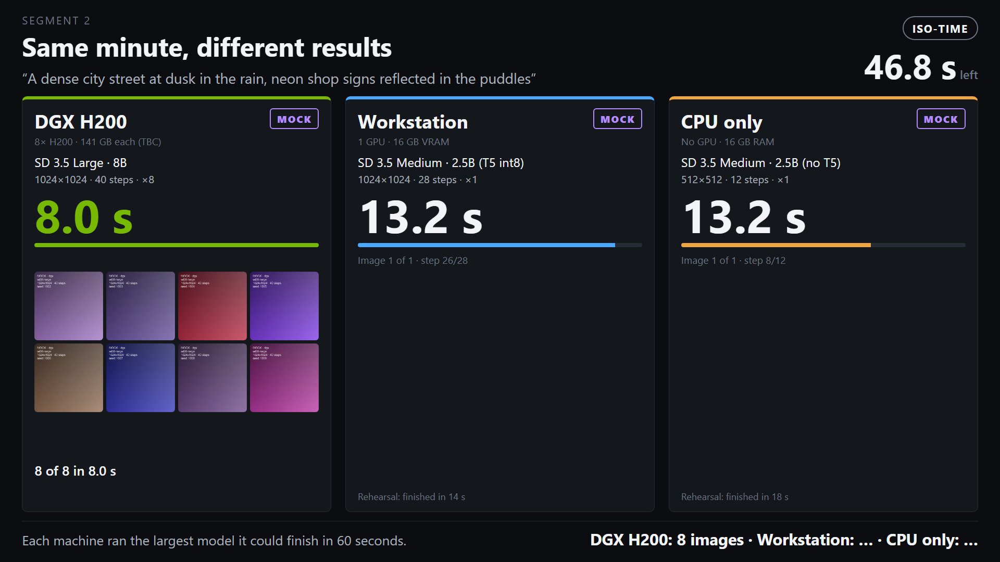
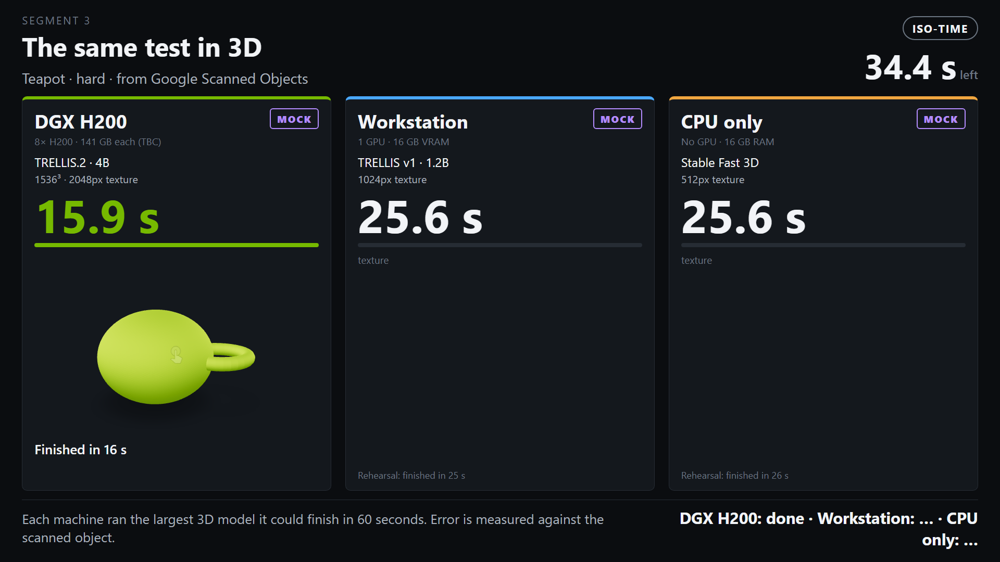
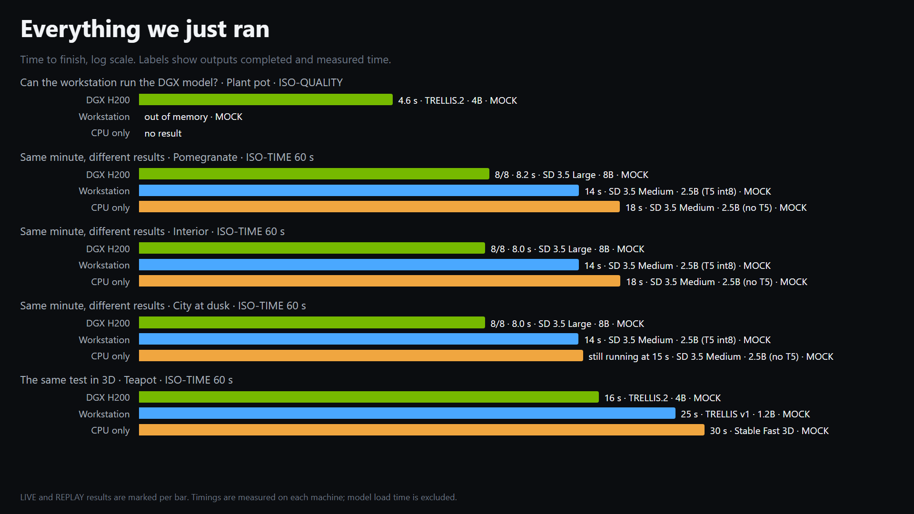
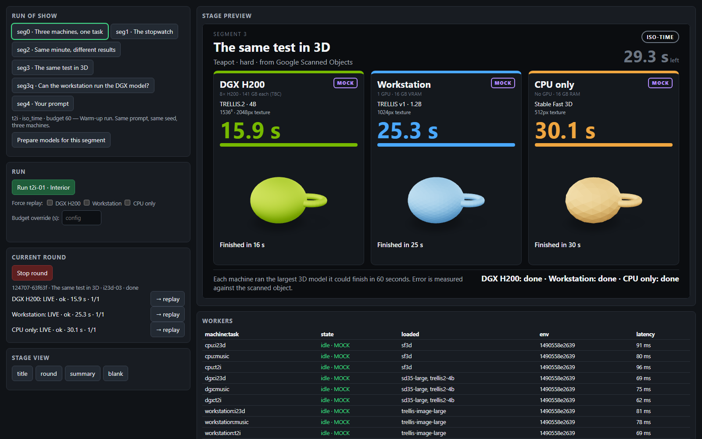

# Hardware Symposium Demo — Engineering Review, Plan and Build

Nov 18, 2026 · companion to `Proposal.md` and the three task specs · code in `demo/`

## Status in one paragraph

The demo software is built and tested end to end on mock workers. It includes a worker service for each machine, the laptop conductor, the stage and operator pages, replay with badges, rehearsal tooling, ground-truth scoring and the input datasets. It cannot be tested on real models yet: none of the target hardware is reachable from here. Those runs are the Day 1 work below. With **3 working days to the event**, the plan is ordered so that Task 1 is live on all three machines by the end of Day 1, before any 3D install risk is taken. Several items in the proposal need correcting before rehearsal; the most important are review findings 1–5. Answers needed from you are at the end.

Decisions already taken: custom web stage UI (not Streamlit), the TRELLIS + Stable Fast 3D ladder for Task 2, and Task 3 (music) built as contract + stub only.

---

## 1. Review findings

Ordered by impact. **Fixed** means the code and config already handle it. **Decide** means it needs you.

| # | Finding | Impact | Status |
|---|---|---|---|
| 1 | **Iso-quality as written cannot run.** Task 1 says every machine runs the DGX row (SD 3.5 Large, 1024², 40 steps, batch 8). The Large transformer alone is ~16 GB in bf16, plus ~9.5 GB for the T5 encoder: it does not load on the 16 GB workstation without CPU offload, and not at all on a 16 GB-RAM CPU box (~32 GB in fp32). Segment 1's story ("the workstation finishes later") is impossible with that row. | Segment 1 | **Fixed.** Iso-quality = SD 3.5 Medium **without T5**, 1024², 28 steps, batch 8, the same on all three machines. It is the largest configuration that is genuinely identical everywhere. |
| 2 | **SD 3.5 Medium does not "fit comfortably" in 16 GB.** Transformer ~4.9 GB + T5-XXL ~9.5 GB + CLIP-L/G ~1.7 GB + VAE ≈ 16.2 GB of weights before activations. The "9.9 GB" in the proposal excludes text encoders. | Workstation, Segments 2 and 4 | **Fixed.** Workstation runs a labelled variant with T5 in int8 (~4.8 GB). It must be measured on Day 1. Fallback: no T5, which costs text legibility on prompt 1. |
| 3 | **"Same seed" does not give the same image across machines.** A CUDA generator and a CPU generator produce different noise for the same seed. Without a fix, iso-quality images differ visibly between machines, and the "same result, different time" claim is false. | Credibility of Segment 1 | **Fixed.** Noise always comes from a CPU generator, one per image (seed + i), so image *i* is the same whichever GPU (or how many) produced it. Expect only bit-level differences. |
| 4 | **The 16 GB machines cannot hold two models at once.** The workstation swaps three times: seg 1→2 (Medium-no-T5 to Medium-int8-T5), seg 2→3 (to TRELLIS) and seg 3→4 (back). The CPU box swaps twice. The DGX keeps everything resident. | Run of show | **Fixed in software:** a "Prepare" button swaps models off the clock. **Decide:** narrate over the swap (rehearse its duration on Day 2). |
| 5 | **GSO has no chair.** The only GoogleResearch furniture items are multi-piece kids'-room sets. The "hard" teapot also hides its spout from any single fixed view, and its white glaze carries no texture. | Segment 3 inputs | **Fixed, please confirm:** easy = plain plant pot, medium = blue ceramic orchid pot with cut-outs, hard = red patterned mug (thin handle + print). See the contact sheet, `demo/data/i23d/candidates.png`. |
| 6 | **Is a DGX H200 in the room?** It is a ~10U, ~10 kW datacenter system. If it stays in a datacenter, "no internet dependency" breaks and the venue link becomes the biggest risk in the show. | Whole demo | **Decide** (question 1). |
| 7 | **The origin rule contradicts itself across documents.** The proposal's Task 2 table still says Hunyuan3D / Pixal3D are "Excluded by origin" and asks whether TRELLIS's Tsinghua co-authors are acceptable. The Task 2 and 3 specs say the restriction has been lifted. | Document consistency | Ladder chosen (TRELLIS + SF3D). The proposal text still needs updating. |
| 8 | **TRELLIS.2 is not "MIT all the way down".** At load it fetches `facebook/dinov3-vitl16-pretrain-lvd1689m` (gated, DINOv3 licence) and `briaai/RMBG-2.0` (gated, **CC BY-NC 4.0**). Our RGBA inputs skip background removal, but RMBG is still downloaded and loaded. | Licensing claim on stage | **Decide** whether this matters for the event. Both gated licences must be accepted today either way. |
| 9 | **Stable Fast 3D runs on CPU natively**, as a single feed-forward pass (`SF3D_USE_CPU=1`). The proposal assumes the CPU 3D cell is "likely replay". | Segment 3 story | Config now runs it **live**. Measure on Day 1. If it finishes in budget, the message becomes "CPU can do 3D, just far worse", not "CPU cannot". |
| 10 | **TRELLIS.2's 24 GB figure is upstream's stated minimum**, not a measured failure. The pipeline defaults to `low_vram=True`, so it may load on 16 GB at 512³. If it does, the "workstation genuinely cannot" moment is not true. | Segment 3 iso-quality | Test on Day 1. Only claim what we measure. |
| 11 | **TRELLIS.2 at 1536³ ≈ 60 s on an H100** (upstream). Inside a 60 s budget that leaves no margin. | Segment 3 | Config starts at 1536. Rehearsal will likely move the DGX to 1024³ (~17 s). |
| 12 | **The live audience prompt has no content guard.** SD 3.5 ships no safety checker, and this runs in front of press. | Segment 4 | **Fixed:** the operator types the prompt (never the audience), a blocklist check runs (override needs a tick-box), and 8 pre-vetted fallback prompts are one click away. **Decide** go/no-go after the Day 2 test. |
| 13 | TRELLIS v1 loads DINOv2 through `torch.hub`, i.e. from GitHub, at first load. | Offline at venue | Run once online. `verify_offline.py` fails if anything still reaches the network. |
| 14 | The spec's "one blocking POST per run" gives no progress, no cancel, and loses the whole result to a single network blip. | Robustness | **Changed:** submit-and-poll. Every field from the spec responses is kept. |
| 15 | 3D samplers cannot be interrupted mid-stage, so a "stop at budget" rule cannot be enforced. | Segment 3 | A run that crosses the budget finishes and is shown as "Finished after the bell, at 74 s". It is never presented as in-budget. |
| 16 | `torch.cuda.max_memory_allocated()` undercounts what `nvidia-smi` shows. | Measurement | Both allocated (spec) and reserved are logged. |
| 17 | The Streamlit + CDN 3D viewer would fail with no internet. | Stage | **Fixed:** custom page, model-viewer 3.5.0 stored locally, system fonts only. |
| 18 | "Stable Diffusion 4" check | Model choice | No Stability AI announcement found; only unsourced pages claim one. SD 3.5 stays. |
| 19 | The TensorRT FP8 "fourth bar" | Scope | **Cut.** Not achievable in 3 days with engine builds per GPU. |
| 20 | Headline "what takes the workstation an hour, the DGX does in a minute" | Press quote | Do not pre-write it. With batch 8 over 8 GPUs vs 8 sequential images, expect roughly 8 × (per-GPU speed ratio). Quote only the measured number. |

---

## 2. Plan and milestones (3 working days)

The day labels count back from the event. Each day ends in a gate, and each gate has a pre-decided cut.

### Day 0 — today, remaining hours: unblock

- [ ] On Hugging Face, with the account the machines will use, accept the licences for **SD 3.5 Large, SD 3.5 Medium, Stable Fast 3D, DINOv3 (`facebook/dinov3-vitl16-pretrain-lvd1689m`), RMBG-2.0 (`briaai/RMBG-2.0`)**. Then create a read token.
- [ ] Answer the hardware questions in §7. They decide the network setup and whether TRELLIS can be installed at all (Linux only).
- [ ] Start `download_weights.py` on all three machines overnight.
- [ ] Start the TRELLIS.2 and TRELLIS v1 installs (`setup.sh`, compiled CUDA extensions; upstream budgets a day).

### Day 1 — Task 1 live on every machine; 3D installs land

- [ ] Text-to-image env on the DGX, then `pip freeze` → lock, then the same lock on the workstation and the CPU box (`locks/README.md`).
- [ ] `verify_offline.py` PASS on all three, with networking off.
- [ ] Workers up. Conductor on the laptop drives all three over the **real** network; the operator page shows no env-hash warning.
- [ ] Measure: workstation peak memory with T5 int8 (finding 2); the CPU box with Medium-no-T5 (finding 1). If the CPU does not fit, switch to SD 1.5, labelled as an earlier generation.
- [ ] Measure: SF3D on the CPU box (finding 9); TRELLIS.2 load on the workstation at 512³ and 1024³ (finding 10).
- [ ] Overnight: `rehearse.py --segments seg1 --max-wait 14400` (CPU iso-quality takes hours).

**Gate D1:** real images on all three machines in the stage UI. **Cut:** if TRELLIS.2 has not produced a mesh on the DGX by end of Day 1, Plan B for Segment 3: TRELLIS v1 on the DGX against SF3D on the workstation and the CPU. The boundary story is weaker but honest. If no 3D runs at all, Segment 3 is cut and Segment 2 gains a 30 s vs 60 s budget comparison.

### Day 2 — rehearsal matrix, replay table, freeze

- [ ] `rehearse.py --segments seg0,seg2,seg3,seg3q --repeat 3`. From the printed timing table, fix the budget (30–60 s) and each machine's tier in `config/demo.yaml`. Re-run any cell whose settings changed.
- [ ] Scoring sanity on real meshes: a visibly good mesh must score better than a visibly bad one.
- [ ] Failure drill on the real machines: unplug one worker mid-round and confirm the cell goes REPLAY with its reason.
- [ ] Live-prompt test: run the 24 PartiPrompts + 8 fallbacks on the Segment 4 settings and count unusable outputs. Go/no-go on Segment 4.
- [ ] Time the model swaps (Prepare) and write the narration that covers them.
- [ ] Freeze: lockfiles, configs, replay table. No `pip install` after this point.

**Gate D2:** every cell of every segment has a replay record (or a recorded failure), and the budget is fixed. **Cut:** the live audience prompt, unless the failure count is low and the guard is accepted.

### Day 3 — venue dress rehearsal

- [ ] All three machines plus the laptop on our own switch, with static IPs (finding 6). Full run-through twice, timed against the 40-minute plan.
- [ ] Projector check: clocks readable at the back, meshes rotate smoothly.
- [ ] "Pull the cable" test: with all workers unreachable, the whole show still runs from replay, every cell badged.
- [ ] Decide who operates the console and who narrates.

---

## 3. Requirements

| Area | Requirement |
|---|---|
| OS | Linux on both GPU machines: TRELLIS / TRELLIS.2 are Linux-only upstream. CPU box: Windows or Linux, one setup/start script for each (`demo/scripts/cpu/`). Secrets (HF token, worker token) live in `config.txt` beside `demo/`, read at run time. |
| GPU stack | CUDA 12.4 toolkit and a matching driver. TRELLIS.2 uses PyTorch 2.6 / CUDA 12.4; TRELLIS v1 defaults to PyTorch 2.4 / CUDA 11.8. They need **separate envs**, which is why each task runs as its own worker process. |
| Python | 3.10 or 3.11 in every worker env, the same minor version per task across machines. |
| Disk | Plan for ~100 GB of model cache per GPU machine (SD 3.5 Large + Medium diffusers folders, TRELLIS.2, TRELLIS v1) and ~30 GB on the CPU box. Confirm against the actual download sizes. |
| Network | One wired switch, static IPs, no venue Wi-Fi in the data path. Workers listen on 8101 (t2i) and 8102 (i23d), with a shared token in `ARC_DEMO_TOKEN`. |
| Accounts | One Hugging Face account with every gated licence accepted (Day 0 list). |
| Laptop | Python 3.12 + `requirements/conductor.txt`, Edge or Chrome full-screen on the projector output. |
| Licences to record | Stability AI Community (SD 3.5, SF3D: check the $1M revenue threshold against your organisation), MIT (TRELLIS, TRELLIS.2), DINOv3 licence, CC BY-NC 4.0 (RMBG-2.0), CC BY 4.0 (GSO: attribution on the slide), model-viewer BSD-3. |

## 4. Model loading

Models load at worker start (preload) or on **Prepare**, never inside a measured clock. `load_seconds` is logged separately. A model loaded inside a job (only the deliberate TRELLIS.2-on-workstation attempt) is flagged in the run log.

| Machine | t2i worker holds | i23d worker holds | Swap needed |
|---|---|---|---|
| DGX H200 | `sd35-large` on every GPU (batch 8 = 1 image per GPU, round-robin) | `trellis2-4b` on GPU 0 (`low_vram` off, via `model_overrides`) | No: both stay resident |
| Workstation 16 GB | `sd35-medium-t5int8` | `trellis-image-large`; `trellis2-4b` only for the OOM moment | **Yes**: Prepare unloads the other worker first (`one_task_at_a_time`) |
| CPU 16 GB | `sd35-medium-not5` (fp32; bf16 only with AMX) | `sf3d` | **Yes**, for RAM |

Every variant is a named key in `demo/config/models.yaml` with its label (for example "SD 3.5 Medium · 2.5B (T5 int8)"), so a memory compromise always appears on screen and never happens silently. CPU offload and attention slicing are not used at all, since both distort timing.

## 5. Implementation (`demo/`)

```
operator laptop                                   each machine under test
conductor :8000  ── job JSON ──▶  worker t2i :8101  (diffusers env)
 /stage /operator ◀─ status + files ── worker i23d :8102 (TRELLIS / SF3D env)
 replay/  session/runs.jsonl                       clock + memory measured HERE
```

- **Worker** (`arcdemo/worker`): one job at a time. The clock starts after the model is loaded and stops when the last file is written, with CUDA synchronised first. Peak memory is reset per job. Statuses: `ok`, `budget_exceeded`, `out_of_memory` (shown as a result), `error` (triggers replay), `cancelled`. Text-to-image cuts off at the budget with a step callback and returns finished images only.
- **Conductor** (`arcdemo/conductor/core.py`): sends the same input to all machines at once and polls each independently, so a slow machine never blocks a fast one. It downloads outputs as they land and scores meshes against the scan. An unreachable or erroring worker, or one silent past budget + 15 s, switches that cell to **REPLAY**, with the reason shown and logged. Replays reveal each output at its rehearsal time. Every cell writes one measurement record (all fields from the proposal's Measurement table) to `session/runs.jsonl`.
- **Replay table** (`replay/<task>/<protocol>/<machine>/<input>/`): filled by `rehearse.py` with the **median** of the repeats, never the best. A settings hash flags stale records on stage.
- **Scoring** (`arcdemo/scoring.py`): centroid / RMS-radius normalisation, a search over 24 axis rotations plus rigid ICP, then Chamfer ×100 and F-score@0.05. On the three real GSO scans: a scan against itself (rotated, rescaled, exported as GLB) scores **1.6–1.7**, a different object **8.4–13.3**. About 7 s per mesh on the laptop.
- **Traceability**: every log line carries a time and source. Worker lines carry the job's `run_id`, which the conductor logs at dispatch, so one `grep` follows a cell across machines. No exception is swallowed silently.
- **Tests**: 14 automated (`python -m pytest`): config validation, scoring sanity, the worker budget cutoff, OOM-as-result, unknown-field rejection, one-model-at-a-time, busy rejection, a full conductor round on three mock worker processes, and the dead-worker fallback.

## 6. Test dataset

| Set | Contents | Purpose |
|---|---|---|
| Stage prompts | The 3 proposal prompts, seeds 1001–1003, plus a `live` slot (seed 4242) | Segments 0–2 and 4 |
| Rehearsal prompts | 24 PartiPrompts, sampled deterministically (seed 2026), 4 each from Quantity, Writing & Symbols, Fine-grained Detail, Perspective, Properties & Positioning, Complex; People category excluded. Script: `build_rehearsal_prompts.py` | Timing spread; failure rate for unrehearsed prompts (go/no-go for Segment 4) |
| Live fallbacks | 8 pre-vetted prompts, one click in the operator console | Segment 4 when the audience prompt is unusable |
| 3D inputs | 3 GSO objects (CC BY 4.0), each rendered once at a fixed camera (20° elevation, 35° azimuth, 35° FOV, 512² RGBA, transparent background). Scans kept as ground truth. Alternates on the contact sheet. Script: `prepare_gso.py` | Segment 3 and scoring |
| Music | 2 text prompts + 1 continuation (the 10 s seed clip is still to be recorded or sourced) | Reserve task only |
| System tests | Mock workers with configurable speed, OOM and CPU limits | UI build, operator practice, failure drill without hardware |

## 7. UI

Built and working against mock workers. The screenshots below are mock runs, so every cell carries a MOCK badge.

**Stage (projector):** three columns in machine order. Each shows hardware, the model tier and settings, a large clock, progress (image *k* of *n*, step *s*/*t*), outputs as they land (an image grid for batch 8, a rotating mesh for 3D), the result line, error against the scan, and a **LIVE / REPLAY / MOCK** badge. The header shows the protocol (ISO-TIME / ISO-QUALITY) and the budget countdown. The footer carries the honesty caption required by the proposal ("Each machine ran the largest model it could finish in 60 seconds") and a one-line headline. While a cell is still running, its rehearsal time is shown underneath. Out-of-memory is displayed as a result in red, not as an error.




**Summary (Segment 4 opener):** latest run per segment and input, with time to finish on a log scale. Each bar carries direct labels (outputs, time, model, badge), so identity never depends on colour.



**Operator console:** run-of-show buttons, Prepare (model swap), Run per input, force-replay per machine, budget override, the live-prompt box with the check and fallbacks, Stop round, "→ replay" per cell, stage view switch, a live stage preview, and worker health with env hashes.



## 8. Risks (updated)

| Risk | Likelihood | Mitigation |
|---|---|---|
| TRELLIS install not working by end of Day 1 | Medium | Gate D1 Plan B (§2) |
| DGX remote, so the show depends on an external link | Unknown | Question 1; replay covers every cell; pull-the-cable test on Day 3 |
| Workstation SD 3.5 Medium + int8 T5 still too tight | Low–medium | No-T5 variant ready, labelled |
| Live prompt produces something unusable on screen | Medium | Operator-typed prompt, blocklist, fallbacks, Day 2 failure count, cut line |
| Model swap time dead air | Medium | Timed on Day 2, narrated |
| Library versions drift between machines | Low | One lock; env-hash warning on the operator page |

## 9. Questions for you

1. **Where is the DGX H200 on the day:** in the room, or in a datacenter? If remote, what link do we get, and can it be wired rather than over the venue network? How many GPUs, and how much memory each?
2. **Workstation:** which GPU model, and which OS? TRELLIS needs Linux; if it runs Windows, can it dual-boot or run WSL2 by Day 1?
3. **CPU box:** a separate machine, or the workstation with the GPU disabled? If separate, which CPU and how many cores (for bf16/AMX)? If it is the same machine, Segment 1 needs two passes and its CPU column must be replay.
4. **The event date and time**, and when we get the venue for the dress rehearsal.
5. **Which Hugging Face account** accepts the gated licences today? Is your organisation over Stability AI's $1M revenue threshold?
6. **3D objects:** accept the plant pot / orchid pot / patterned mug, or pick from the contact sheet?
7. **Licensing message:** is RMBG-2.0 (CC BY-NC) being loaded inside TRELLIS.2 acceptable for this event, or must every loaded weight be commercially licensed?
8. **Segment 4:** keep the live audience prompt, subject to the Day 2 test, or end on the summary?
9. **If SF3D runs live on the CPU** (finding 9), are you comfortable changing the Segment 3 line from "cannot do it" to "can, but far worse"?
10. **Who operates and who narrates**, and will the operator be available on Day 2 to practise on the console?
