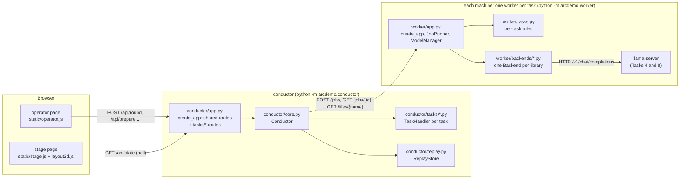
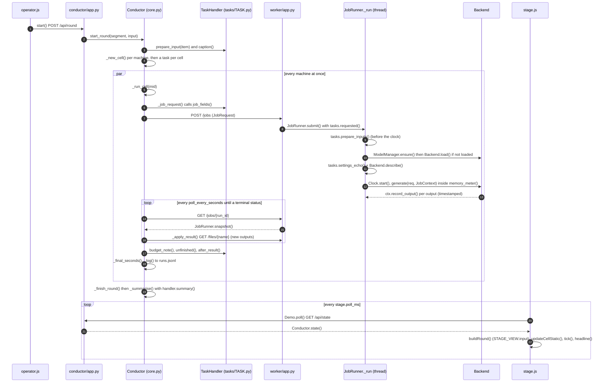
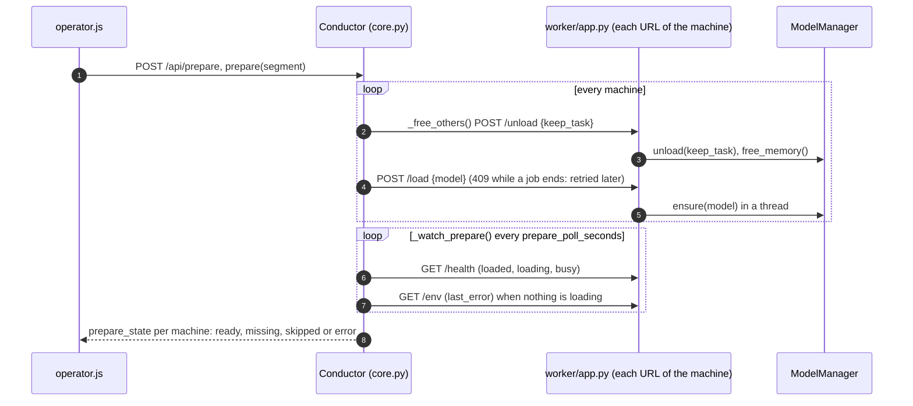
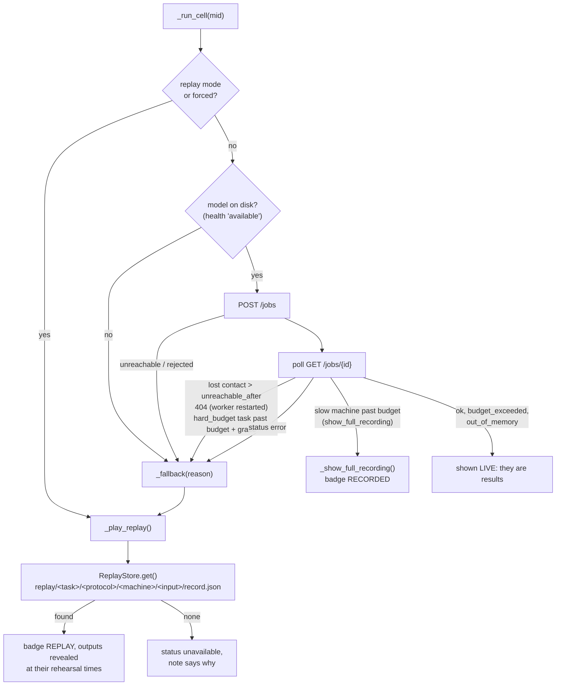
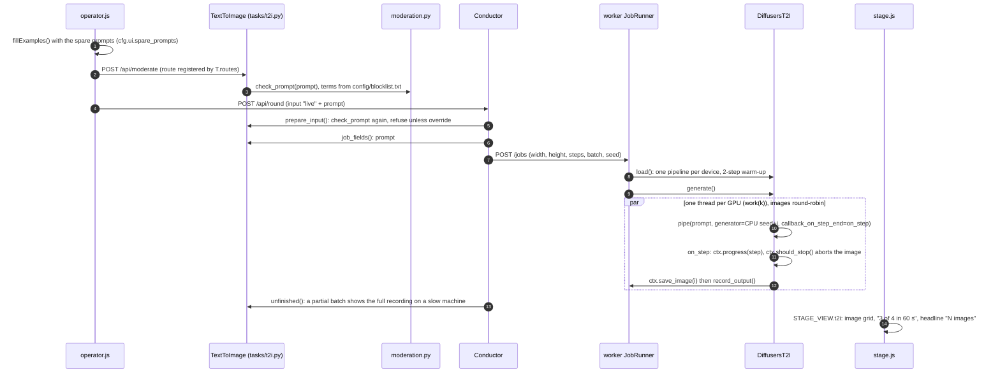
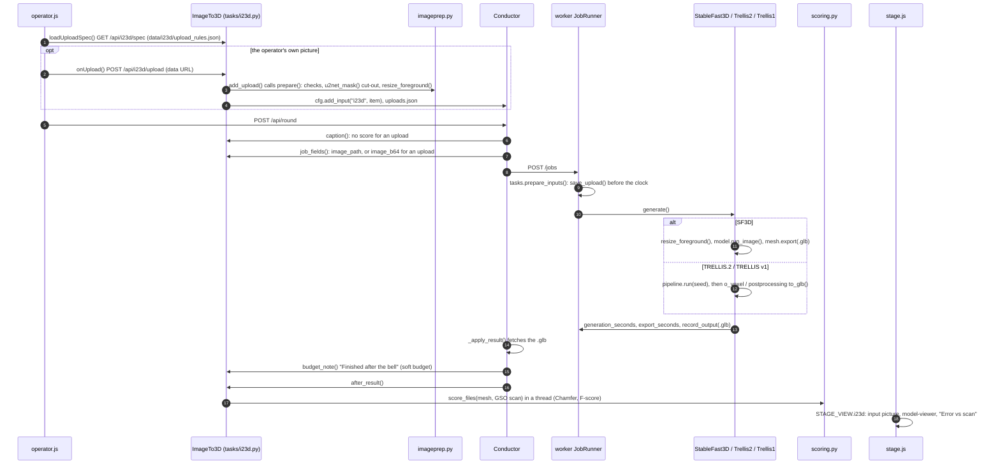
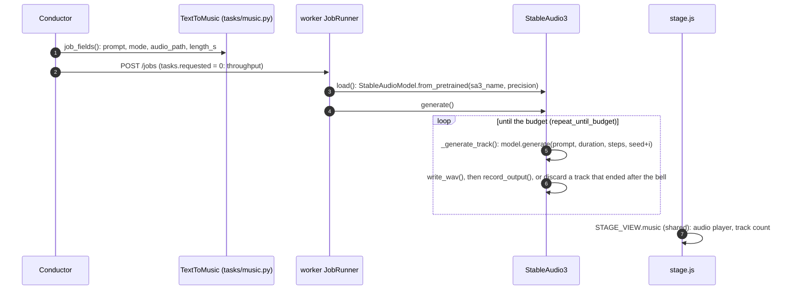
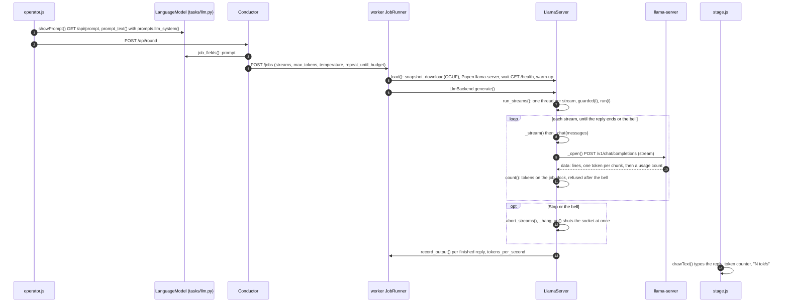
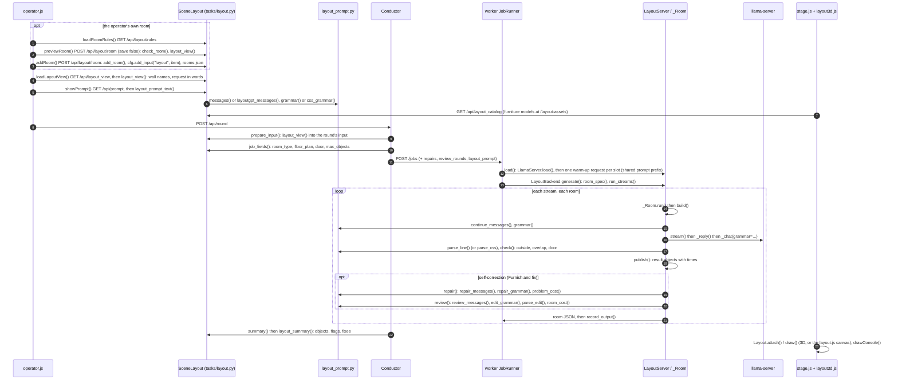

# Call hierarchy

What calls what, from a button on the operator page to the model on each machine. The diagrams use the
names in the code: files are under `demo/arcdemo/` unless they start with `static/` (the pages, in
`arcdemo/conductor/static/`). They render as diagrams on GitHub and in VS Code's Markdown preview.

1. [Processes](#1-processes)
2. [Shared: one round, from Start to the summary](#2-shared-one-round-from-start-to-the-summary)
3. [Shared: Load this task's model (prepare)](#3-shared-load-this-tasks-model-prepare)
4. [Shared: when a machine fails](#4-shared-when-a-machine-fails)
5. [Task 1 — text to image](#5-task-1--text-to-image)
6. [Task 2 — image to 3D](#6-task-2--image-to-3d)
7. [Task 3 — music (reserve)](#7-task-3--music-reserve)
8. [Task 4 — language model race](#8-task-4--language-model-race)
9. [Task 8 — scene construction](#9-task-8--scene-construction)

Where the task-specific code sits:
- **Conductor:** `conductor/tasks/<task>.py` (a `TaskHandler`).
- **Worker:** `worker/tasks.py` (per-task tables) and `worker/backends/<library>.py`.
- **Pages:** `STAGE_VIEW[task]`, `OPERATOR_VIEW[task]` and `TASK_TEXT[task]`.

## 1. Processes

## 2. Shared: one round, from Start to the summary

Every task follows this path. The boxes marked *handler* are where `conductor/tasks/<task>.py` changes it.

## 3. Shared: Load this task's model (prepare)

## 4. Shared: when a machine fails

## 5. Task 1 — text to image

`conductor/tasks/t2i.py` · `worker/backends/diffusers_t2i.py` (mock: `backends/mock.py`)

## 6. Task 2 — image to 3D

`conductor/tasks/i23d.py` · `imageprep.py` · `scoring.py` · `worker/backends/sf3d.py`, `trellis.py`

## 7. Task 3 — music (reserve)

`conductor/tasks/music.py` · `worker/backends/stable_audio3.py` (mock: `backends/music_stub.py`). There is
no segment in `demo.yaml` yet, so the operator cannot start it; the path is ready.

## 8. Task 4 — language model race

`conductor/tasks/llm.py` · `prompts.py` · `worker/backends/llm.py` (mock: `LlmMock`)

## 9. Task 8 — scene construction

`conductor/tasks/layout.py` · `layout_prompt.py` · `worker/backends/layout.py` (mock: `LayoutMock`) ·
`static/layout3d.js`

