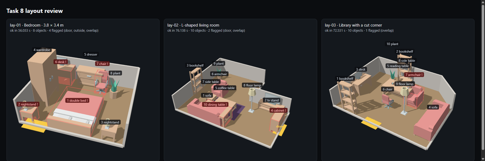
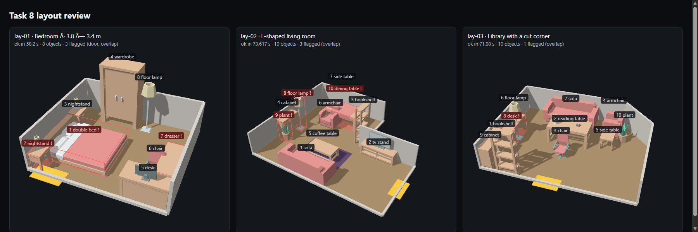
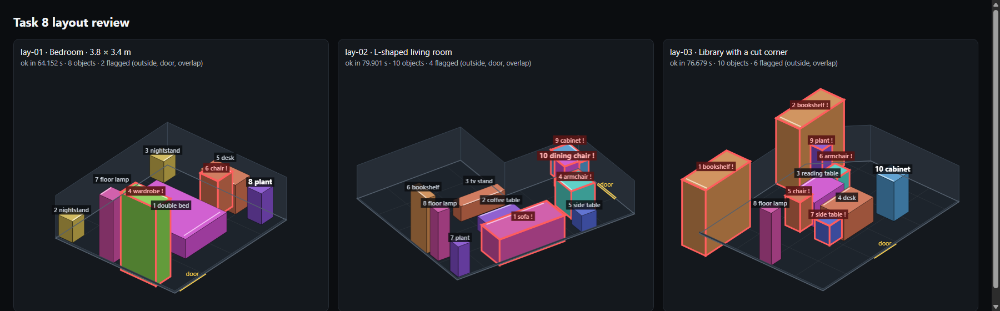
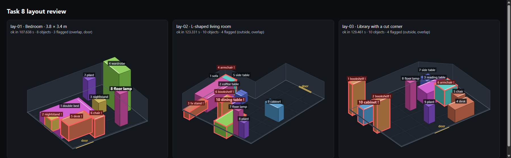
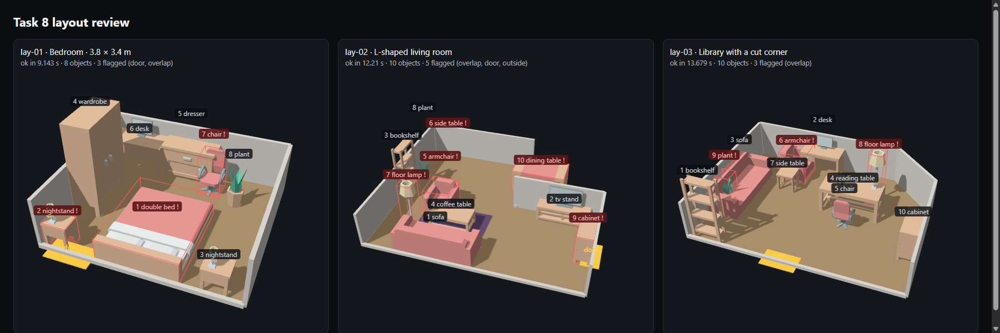
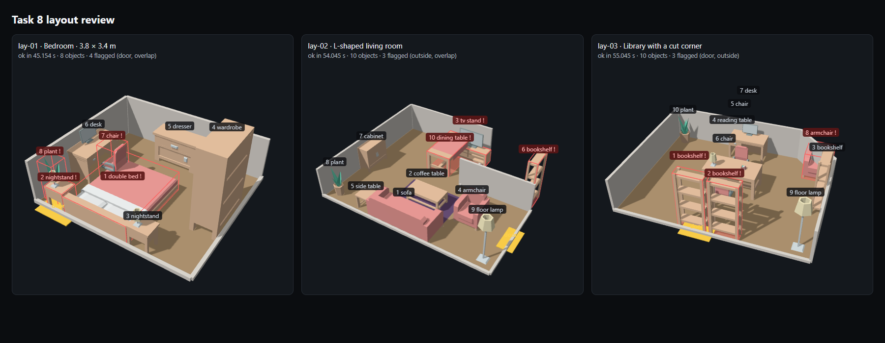

# Task 8 — Layout model review: Qwen3.5 4B placing furniture

21 November 2026 · four prompt rounds on the three stage rooms · laptop CPU, plus the laptop GPU (Vulkan) for v3.1 · 3D stage view with furniture models

## Summary

- **The pipeline works end to end, offline.** Qwen3.5 4B (Q4_K_M) runs under llama.cpp with networking off. The grammar keeps every reply parseable: 112 of 112 objects across four runs parsed. Objects stream in one at a time, and the room checks flag mistakes as they happen.
- **Asking a 4B model for raw coordinates does not work, and prompt wording barely helps.** With v1 and v2 about 40% of objects broke a room rule (12 and 11 of 28). Only 0 and 1 of 9 wall pieces actually stood against a wall, even when v2 spelled out the formula for every wall.
- **Moving the geometry into code does work.** In v3 the model names a wall and a position along it (`wardrobe wall=east at=1.70`), and the worker computes the coordinates. Flagged objects fell to 7 of 28, and 13 of 14 wall pieces stand correctly against their wall. The model still decides what goes where. The remaining flags are genuine choices: furniture by the door, and free-standing pieces placed on top of others.
- **The small model copies examples when it can.** The first v3 run reproduced the bedroom example line for line for the stage bedroom. v3.1 uses example rooms of types that are not on stage (a study, a dining room), and copying fell to one line.
- **v3 is also faster.** Each object now costs 13–16 tokens instead of 37. A room took 56–76 s on the laptop CPU, against 108–129 s for v2. About 30 s of that, before the first object appears, is the model reading the room's own description on the clock. That is the next thing to fix.
- **The stage now shows real furniture.** The Kenney Furniture Kit (CC0, public domain) is drawn in a three.js "dollhouse" view, with a TV on the TV stand, lamps, plants and a monitor on the desk. Flagged pieces get a red frame and label. Everything is local, so it works offline.
- **On a GPU it is about 6× faster, and the rooms change.** On the laptop's GTX 1050 Ti (Vulkan) a room takes 9–14 s, with the first object after 4–6 s. With greedy decoding the GPU builds a *different* room from the CPU: the library differs from its first line. The seg8 caption "same room on every machine" must change (see "On a GPU").
- **Recommendation:** keep v3.1. Next, warm each stage room's prompt during the operator's Prepare step, so the first object arrives in seconds instead of about 30 s. Remove the door stretch from each wall's allowed range, and run the 9B and 122B models on the same rooms.

## What was tested

| | |
| --- | --- |
| Task | Furnish an empty room from its floor plan, one object per line, shown building live (Task 8, LLM layout path) |
| Model | `bartowski/Qwen_Qwen3.5-4B-GGUF`, Q4_K_M (3.0 GB), the same file as the Task 4 language-model race |
| Server | llama.cpp build 12608 (CPU build), started by the worker as `llama-server`, 1 slot |
| Machine | Operator laptop CPU (6 cores, 16 GB RAM), a stand-in for the CPU box. Not yet run on any GPU |
| Settings | Show settings for seg8 "Furnish the room": greedy decoding (temperature 0), one room at a time, up to 400 tokens |
| Rooms | `lay-01` bedroom 3.8 × 3.4 m (8 objects); `lay-02` L-shaped living room (10); `lay-03` library with an angled wall, our own plan (10) |
| Prompt warm-up | The shared part of the prompt (rules and two worked examples) is read once at load, off the clock |
| Tool | `scripts/sample_layout.py --config config/worker-local-cpu.yaml` (laptop configs archived in `/home/master/mayar/archive/arc-2026-demo-laptop/`) |

### The four prompt versions

| Version | What the model writes | What else changed |
| --- | --- | --- |
| v1 | `wardrobe x=3.40 y=1.70 w=1.20 d=0.60 h=2.00 rot=270` for every object | Rules, two example rooms (a bedroom and a living room), the outline |
| v2 | same | Plus every wall with its "back onto it" formula, the object sizes, the door's keep-empty zone, and the areas that are not floor; new example rooms |
| v3 | wall pieces: `wardrobe wall=east at=1.70`; free pieces: `armchair x=2.10 y=3.00 facing=west`; sizes fixed | Named walls with the range of `at`; the grammar allows only this room's wall names, and wall pieces only in the wall form |
| v3.1 | same as v3 | Example rooms of types that are not on stage (a study and a dining room) |

**How a reply is constrained.** A grammar sent with each request fixes the line format, the object names and the number of lines. It never constrains the numbers: which wall, where along it, and where free pieces stand are the model's choices.

**How objects are judged.** Each object is checked against the room and the objects placed before it. Objects are flagged on stage, never corrected.

- *outside*: a footprint corner lies more than 3 cm beyond the outline.
- *overlap*: it overlaps an earlier object by more than 10% of the smaller footprint.
- *door*: it comes within 0.8 m of the door.

## Results

| | v1 | v2 | v3 | v3.1 |
| --- | --- | --- | --- | --- |
| Objects placed / parseable | 28 / 28 | 28 / 28 | 28 / 28 | 28 / 28 |
| **Objects with at least one flag** | **12** | **11** | **7** † | **7** |
| outside · overlap · door flags | 5 · 6 · 4 | 6 · 6 · 2 | 0 · 5 · 2 | 1 · 3 · 3 |
| Wall pieces standing against their wall | 0 of 9 | 1 of 9 | 14 of 14 | 13 of 14 |
| Objects copied from an example (same type, within 0.2 m) | 6 | 1 | 6 † | 1 |
| Room time, lay-01 / 02 / 03 | 64 / 80 / 77 s | 108 / 123 / 129 s | 58 / 74 / 71 s | 56 / 76 / 73 s |
| First object appears | 10.5–11.3 s | 37–44 s | 30–34 s | 30–36 s |

† In v3 the stage bedroom (lay-01) is the bedroom example from the prompt, copied line for line. Its 3 flags come from the example's door being on a different wall. v3's figures are therefore not a fair result for that room. v3.1 fixes the cause.

v3.1, the current version, in the 3D stage view:

v3, with the copied bedroom on the left:

v1 and v2, in the earlier box view:

Red frames and "!" labels mark flagged objects. The numbers give the placement order.

## How the model behaves

**1. It understands the brief, not the geometry.** In every round the model picks a sensible first object (the bed, the sofa, the bookshelves), plausible companions and sensible walls. With raw coordinates (v1, v2) it then fails the arithmetic:

- it gets the facing wrong at the right wall: all six v2 "outside" flags are objects at the west wall turned so their long side runs into it.
- it uses a fixed offset instead of half the object's depth.
- it stacks objects in a column at one x value.

Once the geometry is computed (v3), those errors disappear. That shows the earlier failures were arithmetic, not judgement.

**2. It copies whatever it can.** With v1, six objects landed on example coordinates. With v2, exact copying dropped but the *structure* of the examples carried over: the bed against the west wall at x = 1.00, the sofa at x = 1.80. In v3, the stage bedroom shared its room type with a bedroom example, and the model returned that example word for word. Once the examples were a study and a dining room (v3.1), only one line was copied: `bookshelf wall=west at=2.00`, which is in the study example. For a small model, the examples have to be different enough that copying is never a plausible answer.

**3. With v3.1 the layouts make sense room by room.**

- *Living room:* sofa against the south wall facing north, coffee table in front of it, TV stand on the opposite wall facing the sofa, and bookshelf, cabinet, lamp and plant around the edges. Two flags: a cabinet at the door, and the dining table pushed onto the sofa.
- *Library:* bookshelves on two walls, desk on the west wall, sofa on the east wall, and a reading table in the middle with a chair at it. One flag: an armchair overlapping the reading table.
- *Bedroom:* bed with nightstands either side on one wall, and wardrobe, dresser and desk on the other walls. But the bed and a nightstand sit on the door wall, right at the door, and the desk overhangs the end of its wall. Four flags.

**4. What v3.1 still gets wrong.**

- **The door zone is ignored** (3 flags), although it's given as an x/y range. The model picks a wall, not a stretch of it, and the door is just part of that wall.
- **Free pieces snap to a coarse grid.** Every free piece in v3.1 sits on a 0.5 m grid (x = 1.50, 2.50, 3.50). That's where the overlaps come from: the dining table lands on the sofa, and the armchair on the reading table.
- **The "half the width from the wall end" rule is ignored once.** A 1.2 m desk is centred 0.4 m from the end of its wall.

**5. Greedy decoding gives one fixed room per prompt.** At temperature 0 the same prompt and model produce the same room every time, which is what the "same room, different time" segment needs. A bad room is bad on every run, so the stage rooms must be checked in rehearsal, as here.

## Speed (laptop CPU)

| | v1 | v2 | v3 | v3.1 |
| --- | --- | --- | --- | --- |
| Shared prompt prefix (warmed at load, off the clock) | 1,140 tokens | 2,752 tokens | 2,157 tokens | 2,018 tokens |
| Load + warm-up | 62 s | 195 s | 137 s | 121 s |
| Per-room prompt read on the clock | 131–139 tokens, 3–4 s | 547–676 tokens, 28–33 s | 505–578 tokens, 27–32 s | 505–578 tokens, 27–33 s |
| Writing speed (server-measured) | 4.9–5.0 tok/s | 3.7–4.1 tok/s | 3.4–3.8 tok/s | 3.7 tok/s |
| Tokens per object | ~37 | ~37 | 13–16 | 13–16 |
| Time per object, once started | ~7.5 s | ~9–10 s | ~3.5–4.5 s | ~3.5–4.5 s |

- **Shorter lines more than halved the time per object.** The v3 line format cut each object from 37 tokens to 13–16, so a room now takes about as long as v1 did, despite the much longer prompt.
- **The room description is now the bottleneck.** Wall names, ranges, free zones and the size table are specific to each room, so about 500–580 tokens are read on the clock, roughly 30 s on this CPU before the first object appears. The three stage rooms are fixed, so their full prompts can be warmed in advance (recommendation 1). That would bring the first object down to about 4 s and a whole room to about 30–45 s on this laptop.
- **The prompt warm-up is essential on a CPU.** Without it, each room would also read the 2,000-token shared prefix, about 100 s more. The cache is per server slot, so the worker warms every slot at load. This is disclosed in each run record as `prompt_warmed`.
- **Reading speed is about half v1's** (about 18–20 against 40 tok/s). Part of that is the longer context. Part may be the laptop's own state, which single runs can't separate.
- **The CPU box is not this laptop.** These figures show only the scale: one to two minutes per room on a CPU. That fits the plan to show the CPU's recorded full run when its time is up.

## On a GPU: the laptop's GTX 1050 Ti (Vulkan)

The same model, prompt (v3.1), settings and three rooms, run on this laptop's 4 GB GTX 1050 Ti. The installed NVIDIA driver (512.72) is too old for llama.cpp's CUDA builds (they need CUDA 12.4), so this uses llama.cpp's **Vulkan** build of the same release (b12608), configured in `config/worker-local-gpu-vulkan.yaml`. The show machines will run the CUDA build, so these timings show scale only and should not be compared cell for cell.

| | Laptop CPU | Laptop GPU (Vulkan) |
| --- | --- | --- |
| Room time, lay-01 / 02 / 03 | 56 / 76 / 73 s | **9 / 12 / 14 s** |
| First object appears | 30–36 s | **4.3–6.4 s** |
| Reading the room description (505–578 tokens) | ~18 tok/s, 27–33 s | 92–140 tok/s, 3.8–5.9 s |
| Writing | ~3.7 tok/s | ~19.7 tok/s |
| Load + prompt warm-up (off the clock) | 121 s | 27 s |
| Objects flagged | 7 of 28 | 11 of 28 |

**Getting it to run.**
- The Vulkan device list puts the Intel integrated GPU first, so the config selects the NVIDIA card explicitly (`--device Vulkan1`).
- With default settings, loading more than about 16 of the model's layers onto the card ended in `ggml_vulkan: device lost`, although 24 layers is only about 2 GB of the 3.6 GB free.
- 16 layers loaded, but ran slower than the plain CPU: reading at about 4.5 tok/s.
- Capping each Vulkan memory allocation at 128 MB (`GGML_VK_FORCE_MAX_ALLOCATION_SIZE`) fixed it; a 256 MB cap still failed. With the cap, every layer loads.
- The worker gained a `llama_env` config key to pass such variables to the server. This is a workaround for this laptop's old driver, not something the show machines need.

**Greedy decoding does not give the same room on CPU and GPU.** At temperature 0 each machine's output is deterministic, but the two machines disagree:

| Room | Lines identical before CPU and GPU diverge |
| --- | --- |
| lay-01 bedroom | 5 of 8 (then `desk wall=north at=0.60` on the GPU against `at=0.40` on the CPU) |
| lay-02 living room | 2 of 10 |
| lay-03 library | 0 of 10: the very first line differs (`at=0.50` against `at=1.00`) |

The model often has a near-tie between two numbers. The GPU's slightly different floating-point arithmetic tips it the other way, and every later line then follows a different room. Task 4's spec warned of this for long text, but in Task 8 it shows up within the first lines. The GPU's 11 flags against the CPU's 7 are therefore not evidence that the GPU is worse: they're a different room drawn from the same model.

**For the show**, the seg8 caption "every machine builds the same room… only the clock differs" is not safe. Each machine will very likely build a *different* room from the same prompt. Options:

1. **Change the caption** to say what is true: same model, same prompt, same rules, and each machine's arithmetic leads it to its own room. The comparison is still the time, and the rooms show how fragile small-model choices are. This is honest and arguably more interesting.
2. **Compare rooms per machine across rehearsals** (each machine is deterministic on its own), and make the stopwatch the headline.
3. If identical rooms matter, run the rooms on **one reference machine** and let the others replay them. That stops being a live hardware comparison, so it isn't recommended.

Confirm this on the actual CUDA machines in rehearsal: CUDA and Vulkan differ from each other too.

## The stage view

- **Renderer:** `arcdemo/conductor/static/layout3d.js`, three.js r160.
  - The room is a cut-away "dollhouse": wood floor, walls facing the camera dropped to a kerb, the door marked in yellow, and a slow camera sway, framed to fill each machine's cell.
  - Each object is a furniture model scaled to its exact footprint, so the picture matches the checks. It drops into place when the model writes its line.
  - Labels show the placement order. Flagged pieces get a red frame, a red floor patch and a red label.
- **Models:** the Kenney Furniture Kit 2.0, CC0 (public domain; licence file included). It's 25 GLB files totalling 353 KB, in `arcdemo/conductor/static/assets/furniture/`. Every furniture type has a model, and some carry props: a TV on the TV stand, a lamp on the nightstand and on the reading table, a monitor on the desk, books, and a rug under the coffee table. Being CC0, the models can be photographed and published freely, unlike the 3D-FUTURE meshes the original spec assumed.
- **Offline:** three.js is vendored in `static/vendor/three/`, and the files are byte-identical to the npm package. The stage loads nothing from the internet.
- **Fallback:** `static/layout.js`, the earlier box view, is used automatically when WebGL is unavailable.
- **Checked:** with mock workers in headless Edge (software WebGL) at 1920 × 1080 and 1920 × 1200, and in the review pages above. One thing still needs a look on the real projector machine with a GPU browser: at 1080p, one headless capture showed a strip of the page header repeated along the bottom edge. It didn't reproduce at 1200 or after the framing change, and the 2D view doesn't show it, so it looks like a capture artifact.

## What this means for the show

- **Single-model show (4B everywhere):** seg8 "Furnish the room" works. Every machine builds the same room in the same order, and only the clock differs. With v3.1 the rooms look like rooms, and the remaining flags are few and readable: a cabinet at the door, a table on a sofa. The flags are identical on all three machines, so they say nothing about the hardware. They should be presented as what a small model does.
- **Bigger-model version (`demo-full.yaml`):** v3.1 makes this a fair comparison. The 4B's remaining errors are judgement (the door, crowding) rather than arithmetic, which is exactly where a larger model should do visibly better. The 9B and 122B models have not been run yet.
- **On stage, furniture dropping in reads instantly**, and a red-framed cabinet in the doorway is understood without explanation. Keep flagging, and never auto-correct.

## Recommendations

1. **Warm each stage room's prompt during Prepare.** The stage rooms are fixed, so the conductor's Prepare step can send each room's full prompt once, off the clock. This should bring the first object from about 30 s to about 4 s on a CPU, and it would be disclosed like the current warm-up.
2. **Take the door out of the wall ranges.** Describe the door wall as two stretches, e.g. "south: at from 1.40 to 3.80 (door at 0.60)", so a wall piece placed in range can't land on the door. This still constrains only the options offered, not the model's choice.
3. **Optionally, let free pieces be placed relative to others.** A form like `chair near=5 side=front` ("in front of object 5") would remove the coarse-grid overlaps the same way v3 removed the wall arithmetic. Try it only if the overlaps matter on stage.
4. **Run the same three rooms with the 9B (workstation) and 122B (DGX) models**, using the same tool and settings, before committing to the bigger-model segment.
5. **Rehearse on the CPU box itself** to get real per-room times, and record a full run for seg8.
6. **Check the 3D view on the projector laptop** with its GPU browser at the venue resolution.

## Files

Local results folders (not in git, under `demo/results-local/`). Each holds `summary.md`, `rooms/*.json` (objects, times, checks, raw reply), `review.html` / `review.png`, `prompt.txt`, `worker.log` and `llama-server-qwen35-4b-layout.log`:

| Folder | Run |
| --- | --- |
| `layout-review-laptop-cpu-20261121-202654/` | v1 (its `prompt.txt` was re-rendered from the v1 source after the run) |
| `layout-review-laptop-cpu-20261121-205933/` | v2 |
| `layout-review-laptop-cpu-20261121-211831/` | v3 |
| `layout-review-laptop-cpu-20261121-212602/` | v3.1 (current) |
| `layout-review-laptop-gpu-20261121-221254/` | v3.1 on the laptop GPU (Vulkan) |

To view a review page in 3D, serve `demo/` over HTTP (`python -m http.server -d demo 8765`) and open `/results-local/<folder>/review.html`. Opened directly as a file, it falls back to the box view.

Code:

- `arcdemo/worker/backends/layout.py`: prompt v3.1, wall naming, grammar, line parsing, room checks and the prompt warm-up.
- `arcdemo/conductor/static/layout3d.js`: the 3D stage view, plus the assets and vendored three.js beside it.
- `arcdemo/conductor/static/layout.js`: the fallback box view.
- `scripts/sample_layout.py`: reruns this review.

## Self-correction (24 November 2026)

Segment seg8b "Furnish and fix" (`iso_quality+fix`: greedy, `repairs: 2`, `review_rounds: 3`). The model is told each problem in plain words and fixes it itself. The code never moves furniture, and an edit is kept only if it lowers the room cost. How it works: `Task 8 — Scene construction.md`, Implementation. Same model (Qwen3.5 4B Q4_K_M), prompt v3.1, the three stage rooms, on the laptop's GTX 1050 Ti (Vulkan, b12608). Folder: `results-local/layout-fix-laptop-gpu-v2/`.

| Room | First pass flagged | Final flagged | Fixed (now clean) | Improved, still flagged | Removed | Fix attempts | Room time | Without fixing (21 Nov) |
| --- | --- | --- | --- | --- | --- | --- | --- | --- |
| lay-01 bedroom | 3 of 8 | 1 | 2 | 1 | 0 | 9 | 44 s | 9 s |
| lay-02 living room | 4 of 10 | 2 | 2 | 0 | 0 | 17 | 71 s | 12 s |
| lay-03 library | 3 of 10 | 1 | 2 | 0 | 0 | 8 | 50 s | 14 s |
| **All** | **10 of 28** | **4** | **6** | **1** | **0** | **34** | | |

- **The mechanism works with the real model.** The prefilled continuation, the one-line repairs (the grammar keeps the same object) and the review edits all parse, and every room finished.
- **Flags fall from 10 to 4 of 28.** Most fixes come from the immediate repair. The review fixed what two repairs could not: in the bedroom, the nightstand went from "door" to "overlap" during repair and was clean after a review `move`; in the living room, the dining table was fixed the same way.
- **What stays flagged is mostly small free pieces overlapping** (an armchair and a side table on the coffee table, a dresser on the bed). The model's tries for them snap to the same 0.5 m grid as before, and its review rounds don't move them. Recommendation 3 above (placing free pieces relative to others) targets exactly this.
- **It costs time: about 4–5× a plain room on this GPU** (44–71 s against 9–14 s). Each fix re-reads the prompt so far from the slot cache plus a new turn, and the review writes edits. This is a quality-for-time trade, so it fits iso-quality ("time to a clean room"), and the faster machines have more room for it in iso-time.
- **First version's mistake, fixed before this run:** the cost added metres and m², so three small problems could "cost" less than one large one, and a repair was put back to a try with three problems instead of one. Each problem now also costs a fixed 1, so fewer problems always wins.
- **Not yet run:** the CPU (expect several minutes per room: each repair costs a few seconds of reading and writing there), the bigger models, and the stage animation on the projector machine.

## LayoutGPT's prompt against ours (24 November 2026)

LayoutGPT (Feng et al., NeurIPS 2023; code at github.com/UCSB-AI/LayoutGPT, MIT licence) run on our local model as segment seg8c "The published method" (`iso_quality+layoutgpt`). Same Qwen3.5 4B Q4_K_M, the three stage rooms, greedy decoding, the laptop's GTX 1050 Ti (Vulkan, b12608). Both prompts ran back to back on the same build. Folders: `results-local/layout-compare-gpu-layoutgpt/`, `results-local/layout-compare-gpu-v31/`. Table: `python scripts/compare_layout.py <folder> <folder>`.

**What was kept from the paper:** its instruction text; its CSS-style line (`bed {length; width; height; orientation (degrees); left; top; depth}`, sizes plus the centre from the room's min corner); its condition, which gives the room's **type and size only** (no outline, no door, no walls); and its k-similar examples (the same room type, nearest by 64 × 64 floor mask).
**What had to change:** a local model instead of GPT-4. Our example bank instead of 3D-FRONT, which needs a signed licence: 24 rule-furnished rectangular rooms, `data/layout/exemplars.json`, built by `scripts/build_layout_exemplars.py`, none identical to a stage room. K = 4 examples instead of 8, so a prompt fits a 4,096-token slot. Greedy decoding instead of temperature 0.7. A grammar for syntax only, as for v3.1. The model's written sizes are recorded, but the checks and the stage use standard sizes, as for v3.1, so only placement is compared.

| | v3.1 (ours) | LayoutGPT | v3.1 + self-correction (seg8b) |
| --- | --- | --- | --- |
| Objects flagged (of 28) | 11 | 10 | **4** |
| outside · overlap · door | 1 · 7 · 3 | 3 · 3 · **5** | 0 · 3 · 1 |
| Wall pieces really against a wall | **14 of 14** | 10 of 14 | 14 of 14 |
| Objects copied from an example it was shown (same type, within 0.2 m) | 0 | **23 of 28** | 1 |
| Tokens per object | 13–16 | 65 | 28–46 (incl. fixes) |
| First object | 4.3–4.7 s | 22–25 s | 4.3–4.7 s |
| Room time, lay-01 / 02 / 03 | **9 / 12 / 12 s** | 45 / 54 / 55 s | 44 / 71 / 50 s |

- **Similar flag counts, for a different reason.** LayoutGPT copies: 23 of its 28 objects sit where an object stood in one of the example rooms it was shown. That is what k-similar retrieval invites, and the 4B model takes it literally. The examples are clean rectangles, so the copies are mostly clean too. The room is the nearest example's room, not a design for this floor plan.
- **It cannot see what makes the stage rooms hard.** The condition gives only "max length, max width". So the L-shaped room gets a bookshelf in the missing quarter (outside), and the door is ignored: 5 door flags, among them bookshelves across the library's door. Our v3.1 prompt describes the walls, the cut corner and the door's zone.
- **It is 4–5× slower.** Each line is about 65 tokens (sizes, three coordinates, orientation) against 13–16. The examples change with every room, so they can't be warmed in advance: 22–25 s pass before the first object, against about 4.5 s. On a CPU this would be several minutes per room.
- **Sizes:** the model copied the standard sizes from the examples almost always (one object of 28 differed), so using standard sizes for the checks changed nothing.
- **What would make it fairer:** 3D-FRONT examples (the licence), more of them (K = 8 needs an 8k context), and a bigger model. The paper used GPT-4. A larger model may copy less and reason more, which is the point of the 9B / 122B ladder. Run seg8c on the workstation and the DGX before drawing conclusions about the method itself.

**OptiScene** (NeurIPS 2025): no public code or weights were found (the paper says "will be released"). Nothing to run. If weights appear, the route is a GGUF conversion and a third prompt variant beside these two.

**Recommendation:** keep v3.1 as the stage prompt, and seg8b for the self-correcting version. Use seg8c as an optional "the published method" comparison segment. It reads well on stage when the rooms are shown side by side, but it is slow on a CPU, so play the CPU box's recording.
